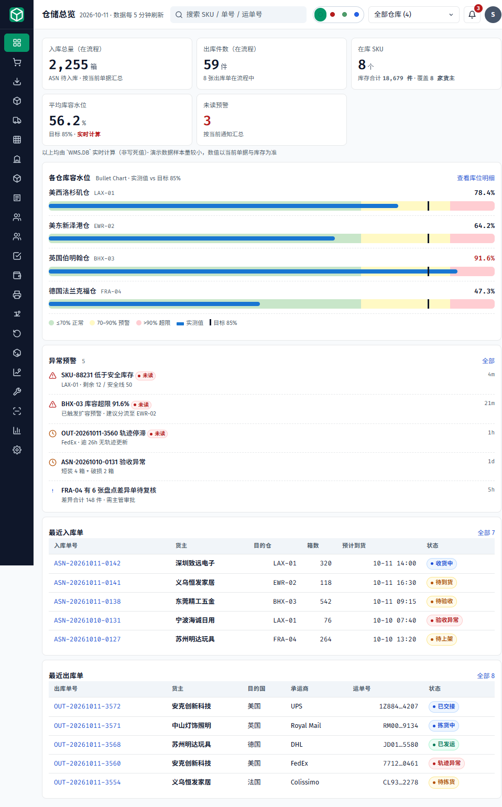
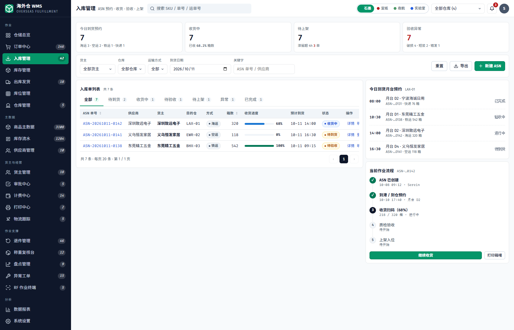
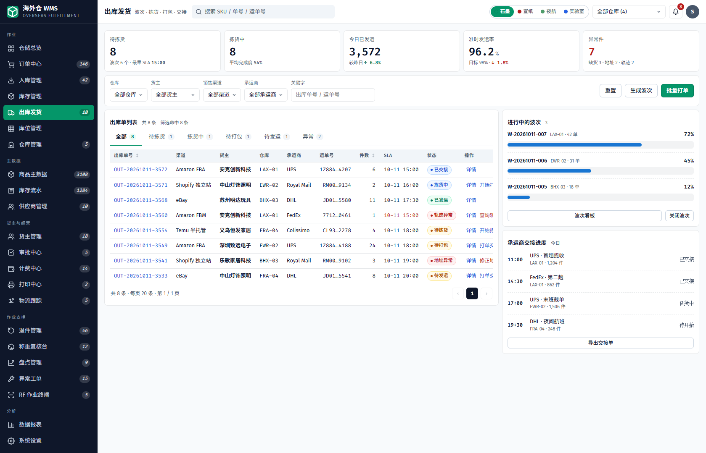
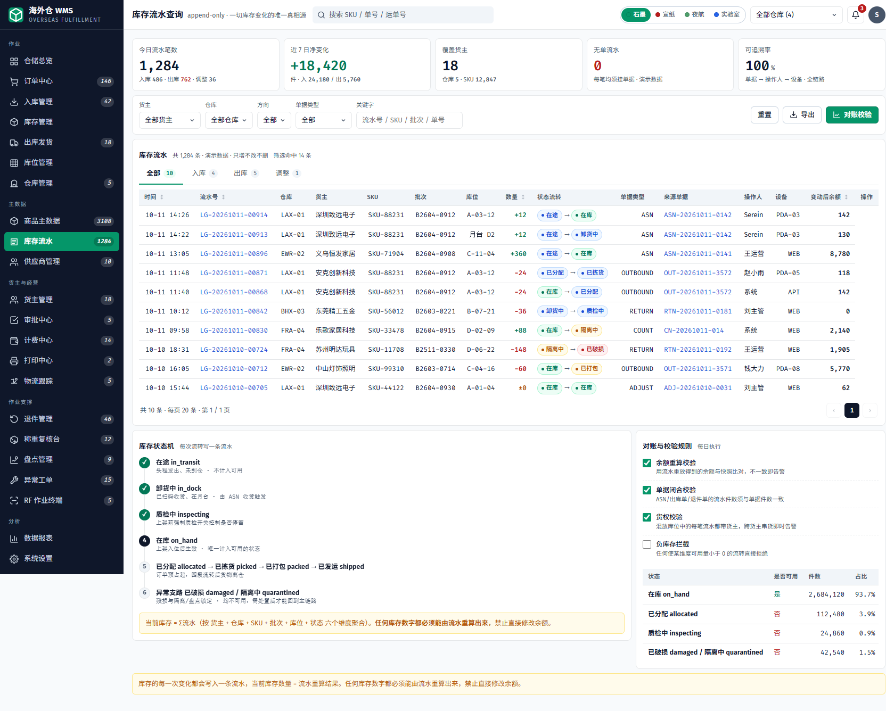
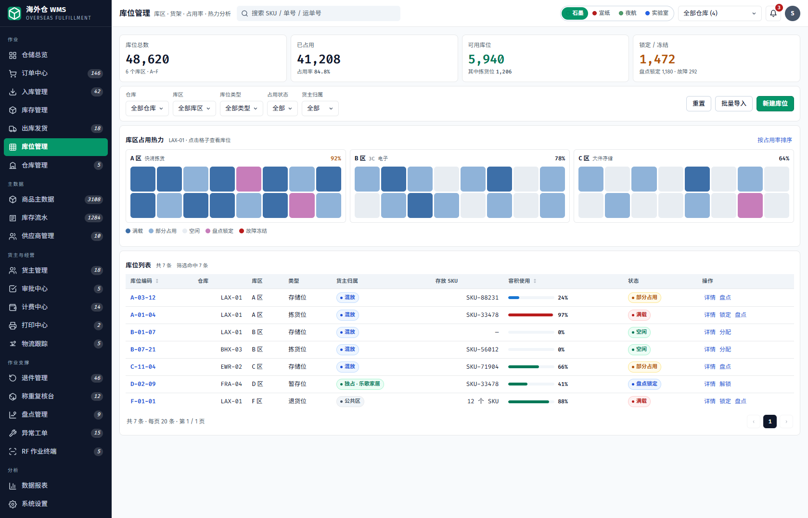
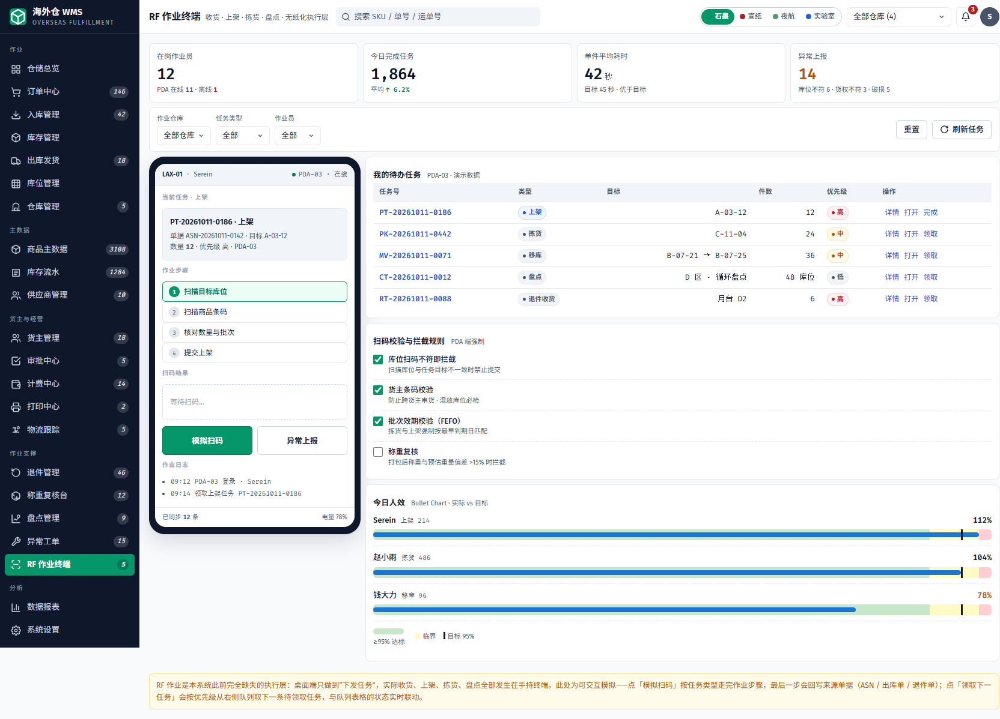

# 海外仓 WMS · Overseas Fulfillment

> Serein WMS UX 静态原型 —— 覆盖海外仓全链路作业的 **22 个页面**高保真原型。
> 零依赖 · 零构建 · 无后端 · 无框架，双击 `index.html` 即可运行。

[]()
[]()
[]()

面向**海外仓运营**（预置美西洛杉矶 / 美东新泽西 / 英国伯明翰 / 德国法兰克福四仓），覆盖从订单、入库（ASN）、库存、出库（波次拣货）、库位、货主、计费、物流跟踪到 RF 作业终端的完整业务闭环。

**核心不变量：库存流水 append-only。** 当前库存 = Σ流水（按 货主 + 仓库 + SKU + 批次 + 库位 + 状态 六维聚合），任何库存数字都必须能由流水重算出来，禁止直接修改余额——全部库存写入收敛在唯一入口 `WMS.stockMove()`。

---

## 目录

- [界面截图](#界面截图)
- [功能说明](#功能说明)
- [技术架构](#技术架构)
- [快速开始](#快速开始)
- [设计规范](#设计规范)
- [目录结构](#目录结构)
- [数据与已知说明](#数据与已知说明)

---

## 界面截图

> 以下均为本地实测截图（默认「石墨」主题）。右上角可切换 **石墨 / 宣纸 / 夜航 / 实验室** 四套主题。

### 仓储总览



KPI（入库在流程 / 出库在流程 / 在库 SKU / 平均库容水位）、各仓库容水位 Bullet Chart、异常预警、最近出入库单，数据每 5 分钟刷新。

### 入库管理 · ASN 预约 / 收货 / 验收 / 上架



入库单列表（收货进度、预计到货、状态）、今日到货月台预约、当前作业流程时间线。

### 出库发货 · 波次 / 拣货 / 打包 / 交接



出库单列表（渠道 / SLA / 异常件数）、进行中的波次进度、承运商交接进度。

### 库存流水 · append-only 唯一真相源



每次库存变化写一条流水（只增不改不删）；**状态流转列由字典驱动**（在途 → 卸货中 → 质检中 → 在库 → 已分配 → 已拣货 → 已打包 → 已发运，异常支路：隔离中 / 已破损），按状态汇总与对账校验规则同页呈现。

### 库位管理 · 库区占用热力



库区占用热力（满载 / 部分占用 / 空闲 / 盘点锁定 / 故障冻结）、库位列表与容积使用率。

### RF 作业终端 · 收货 / 上架 / 拣货 / 盘点 / 无纸化执行层



扫码作业步骤、我的待办任务、扫码校验与拦截规则（库位不符即截停、货主条码校验、批次 FEFO）、今日人效看板。

---

## 功能说明

按左侧导航分组（作业 / 主数据 / 货主与经营 / 作业支撑 / 分析）。

### 作业

| 页面 | 功能 |
| --- | --- |
| `index.html` 仓储总览 | 今日经营 KPI、各仓容水位、异常预警、最近入库 / 出库单 |
| `operations/orders.html` 订单中心 | 订单池、自动分仓决策链、分仓规则、预占与超卖拦截、待处置异常订单；订单状态机：待分仓 → 已预占 → 缺货拦截 / 已下发 / 已退回 |
| `operations/inbound.html` 入库管理 | ASN 预约 · 收货 · 验收 · 上架；到货月台预约、收货进度条、作业流程时间线；ASN 状态机：待到货 → 收货中 → 待验收 → 待上架 → 已完成 / 验收异常 |
| `operations/inventory.html` 库存管理 | 库存明细（可用 / 锁定 / 在途 / 残损隔离）、库存水位分布、批次效期预警 |
| `operations/outbound.html` 出库发货 | 波次 · 拣货 · 打包 · 交接；进行中的波次进度、承运商交接进度、准时发运率；出库单状态机：待拣货 → 拣货中 → 待打包 → 待发运 → 已交接 / 已发运（含轨迹异常、地址异常） |
| `operations/locations.html` 库位管理 | 库区占用热力、库位列表（混放 / 独占 / 公共区）、容积使用率、盘点锁定 |
| `operations/warehouses.html` 仓库管理 | 仓库列表（时区 / 货币 / 状态）、新建仓库流程、仓库运营提醒 |

### 主数据

| 页面 | 功能 |
| --- | --- |
| `master/products.html` 商品主数据 | 商品列表、UOM 计量与换算体系、商品档案字段规范、待补全主数据告警 |
| `master/ledger.html` 库存流水 | append-only 流水账；状态流转、按状态汇总（是否可用 / 件数 / 占比）、对账与校验规则（余额重算、单据闭合、货权、负库存拦截） |
| `master/suppliers.html` 供应商管理 | 供应商列表、供应商 vs 货主身份区分、到货异常记录、供应商到货绩效 |

### 货主与经营

| 页面 | 功能 |
| --- | --- |
| `business/tenants.html` 货主管理 | 货主列表、货权分层（LAX-01）、混放校验规则、货主 × 仓库合作矩阵 |
| `business/approvals.html` 审批中心 | 审批列表、审批类型与后果（通过落库 / 驳回回滚）、审批时效 SLA、超时未处理、审批流程 |
| `business/billing.html` 计费中心 | 计费规则、待计费作业、规则版本与试算、账单与对账；每笔作业自动产生计费事件（`billEvent`） |
| `business/print.html` 打印中心 | 打印任务队列、打印机状态与今日负载、模板管理、打印失败原因 |
| `business/tracking.html` 物流跟踪 | 运单跟踪列表、尾程轨迹时间线、承运商对比、异常处置工单 |

### 作业支撑

| 页面 | 功能 |
| --- | --- |
| `analytics/returns.html` 退件管理 | 退件单、质检分级工作台、货主处置策略、退件作业计费、换标与处置队列 |
| `analytics/pack.html` 打包台 | 打包任务队列、称重校验规则、包材管理、称重拦截与偏差预警 |
| `analytics/count.html` 盘点管理 | 盘点单、差异审批明细、公差与库存锁定规则、盘点执行流程与方式说明 |
| `analytics/tickets.html` 异常工单 | 工单列表、SLA 达成情况、异常类型分布、SLA 计时规则、工单处理流程 |
| `analytics/pda.html` RF 作业终端 | 上架 / 拣货 / 移库 / 盘点 / 退件收货扫码作业，扫码校验与拦截规则，今日人效（Bullet Chart 实际 vs 目标） |

### 分析

| 页面 | 功能 |
| --- | --- |
| `analytics/reports.html` 数据报表 | 出入库吞吐趋势、各仓时效达成、报表库 |
| `analytics/settings.html` 系统设置 | 基础信息、库存与作业策略、渠道与承运商集成、危险操作、用户与权限 |

### 全局能力

- **四套主题**：石墨（默认）/ 宣纸 / 夜航 / 实验室，右上角即时切换，`localStorage` 记忆
- **仓库切换**：顶栏仓库下拉；页面通过 `body[data-wh-col="N"]` 声明仓库所在列，联动全局过滤
- **表格引擎**：关键字按列过滤（`data-filter-col`，逗号 = 多列「或」）、方向 Tab 筛选、点击表头排序（数字感知 / 中文 `localeCompare`）、分页
- **单据抽屉**：`data-drawer="kind:id"` 打开详情与作业轨迹
- **业务动作**：`data-action="kind:id:key"` 走 `WMS.ACTIONS`，改数据 → 重渲染 → toast 反馈；库存动作全部经 `WMS.stockMove()` 落流水
- **CSV 导出**：`data-export`
- **重置演示数据**：右上角头像菜单 →「重置演示数据」

---

## 技术架构

### 技术栈

原生 **HTML + CSS + Vanilla JavaScript**（ES5 风格 IIFE、字符串模板拼接），无构建、无框架、无包管理器、无后端调用。字体使用 Google Fonts（`Fira Code` 数字等宽 + `Fira Sans` 界面）。

### 分层与脚本加载顺序

每个页面固定按序加载，模块扩展（`mod-*.js`）最后注入：

```
data.js → shell.js → ui.js → app.js → actions.js → mod-*.js
```

| 文件 | 职责 |
| --- | --- |
| `assets/data.js` | `WMS.DB` 演示数据（asn / sku / out / loc / rpt / usr / notify / wave / order / ret / retn / tenant / bill / pda / wh / ledger / billEvent）+ **状态字典** + `statusText` / `statusTextOf` 助手 |
| `assets/shell.js` | 共享外壳：侧边栏 `NAV_ITEMS`（按 `body[data-page]` 高亮）、顶栏、仓库切换、主题切换、跨目录相对路径推导 |
| `assets/ui.js` | 交互引擎：过滤、排序、Tab、分页、toast、模态、确认框 |
| `assets/app.js` | `WMS.RENDER.<kind>` 行渲染、抽屉详情（`fieldsOf` / `LINES_EXTRA`）、操作列（`WMS.OPS` 按状态门禁） |
| `assets/actions.js` | 业务动作 `WMS.ACTIONS`、**`WMS.stockMove()` 库存唯一写入口**、表单、CSV 导出 |
| `assets/mod-*.js` | 模块扩展：审批 / 打印 / 供应商 / 物流跟踪 |
| `assets/wms.css` | 唯一样式表：设计令牌 + 全部组件 |
| `assets/themes.css` | 四套主题令牌 |

### 状态字典（全站唯一状态词源）

```
WMS.STATUS       全局状态 → 徽章（cls + text）
WMS.STATUS_BY    业务域命名空间：ledger / stock / asn / out / ret / retn /
                 tenant / bill / pda / wh / loc / rpt / usr
WMS.STATUS_TEXT  各域状态中文名（Tab 计数 / 确认弹窗 / 操作反馈）
WMS.statusText(kind, key)    → 徽章 HTML
WMS.statusTextOf(kind, key)  → 纯中文名
```

库存状态（`stock` 域）驱动库存流水的「状态流转」列与状态机面板：`在途 / 卸货中 / 质检中 / 在库 / 已分配 / 已拣货 / 已打包 / 已发运 / 隔离中 / 已破损`。新增状态只需在字典加一行。

### 声明式 data 属性

| 属性 | 作用 |
| --- | --- |
| `data-render="kind"` | `<tbody>` 交由 `WMS.RENDER.<kind>` 渲染 |
| `data-drawer="kind:id"` | 打开单据详情抽屉 |
| `data-action="kind:id:key"` | 执行业务动作（`WMS.ACTIONS`） |
| `data-form="kind"` | 打开新建 / 编辑表单 |
| `data-export="文件名"` | CSV 导出 |
| `data-toast="文案"` | 演示占位 toast（静态展示页使用） |
| `data-filter-col="3" \| "1,4,5"` | 工具栏按列索引过滤（逗号 = 或） |
| `th.sortable` / `.tab` / `.page-btn` / `[data-reset]` | 排序 / 方向筛选 / 分页 / 重置 |
| `body[data-wh-col="N"]` | 声明仓库所在列，供顶栏仓库切换全局过滤 |

### 数据流

```
用户操作 → WMS.ACTIONS / WMS.stockMove（唯一写入口）
        → 改 WMS.DB + 自动追加 ledger / billEvent
        → WMS.save() 序列化到 localStorage（键 wms.db.v1）
        → renderAll() 全表重渲染 → toast 反馈
```

---

## 快速开始

**方式一：直接打开（推荐）**

双击 `index.html` 即可，无需安装任何东西。

**方式二：本地静态服务**

```bash
# 托管 wms 的上级目录，使 URL 形如 http://localhost:8080/wms/xxx.html
cd ..
python -m http.server 8080      # 或 npx serve .
```

访问 `http://localhost:8080/wms/index.html`。

> 说明：侧边栏的相对路径依赖 URL 中的 `/wms/` 片段推导当前目录，因此用静态服务时请托管上级目录；直接以 `file://` 打开不受影响。

**重置演示数据**：页面右上角头像 →「重置演示数据」，恢复 `WMS.DB` 初始状态。

---

## 设计规范

- **四主题**（`themes.css`）：石墨 `graphite`（默认）、宣纸 `paper`、夜航 `nightshift`（深色）、实验室 `lab`
- **徽章五色**（`wms.css`）：`b-done` 成功绿 / `b-ing` 进行蓝 / `b-wait` 等待黄 / `b-err` 异常红 / `b-neutral` 中性灰；**状态不只靠颜色，均带文字**
- **设计令牌**：颜色 / 圆角（`--r-ctl` 6px、`--r-card` 8px）/ 间距（`--grid-gap` 8px）/ 表格行高 36px / 侧栏宽 232px / 动效 100–150ms，全部走 CSS 自定义属性，组件只从既有 class 取用
- **可访问性**：`skip-link`、`aria-label` / `aria-current` / `aria-selected` / `aria-sort`、`focus-visible` 焦点环，徽章与图标均附文字

---

## 目录结构

```
wms/
├─ index.html                  # 仓储总览（仪表盘）
├─ assets/
│  ├─ wms.css                  # 设计系统：令牌 + 全部组件（唯一样式表）
│  ├─ themes.css               # 四套主题令牌
│  ├─ data.js                  # WMS.DB 演示数据 + 状态字典
│  ├─ shell.js                 # 共享外壳：导航 / 顶栏 / 仓库与主题切换
│  ├─ ui.js                    # 交互引擎：过滤 / 排序 / Tab / 分页 / toast
│  ├─ app.js                   # WMS.RENDER 行渲染 / 抽屉 / 操作列
│  ├─ actions.js               # 业务动作 / stockMove 写入口 / 表单 / 导出
│  └─ mod-{approval,print,supplier,tracking}.js
├─ operations/                 # 作业：订单 · 入库 · 库存 · 出库 · 库位 · 仓库
├─ master/                     # 主数据：商品 · 库存流水 · 供应商
├─ business/                   # 货主与经营：货主 · 审批 · 计费 · 打印 · 物流跟踪
├─ analytics/                  # 作业支撑与分析：退件 · 打包 · 盘点 · 工单 · RF · 报表 · 设置
├─ screenshots/                # README 截图
└─ docs/                       # 规划与修复文档（本地保留，已被 .gitignore 忽略）
```

---

## 数据与已知说明

- 本项目为 **UX 原型 / 前端演示**，不含真实后端、账号权限与并发控制；全部数据为演示数据
- 演示数据存于 `localStorage`（键 `wms.db.v1`），刷新页面不丢失；主题偏好存于 `wms.theme`
- 商品主数据 / 打包台 / 盘点管理 / 异常工单四个页面为**静态展示壳**（仅加载 `shell.js` + `ui.js`），部分按钮为 `data-toast` 占位反馈
- `docs/` 目录存放差距分析、架构改造与修复清单等过程文档，已加入 `.gitignore`
